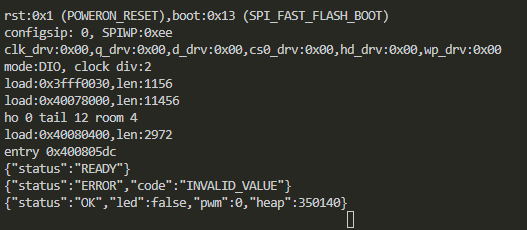
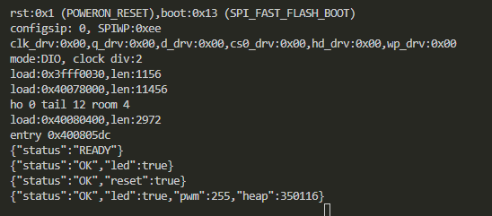
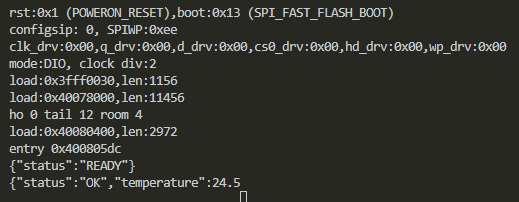

# Defects

## System declines PWM value 100

### Environment
- Wokwi
- ESP32: wokwi-esp32-devkit-v1
- Firmware:
- Date: 21.10.2026

### Preconditions
Start simulation

### Steps to reproduce
1. Send command `SET PWM 100`
2. Send command `STATUS`

### Expected result
1. System responds with `{"status": "OK", "pwm": 100}`
2. System responds with message containing `"pwm": 100`

### Actual result
1. System responds with `{"status": "ERROR", "code": "INVALID_VALUE"}`
2. System responds with  `{"status":"OK","led":false,"pwm":0,"heap":350140}`

### Reproducibility
Always

### Severity
Major

### Evidence

## RESET command doesn't reset led and pwm values

### Environment
- Wokwi
- ESP32: wokwi-esp32-devkit-v1
- Firmware:
- Date: 21.10.2026

### Preconditions
Start simulation

### Steps to reproduce
1. Send command `SET LED ON`
2. Send command `RESET`
3. Send command `STATUS`

### Expected result
3. System responds with message containing `"led": false, "pwm": 0`

### Actual result
3. System responds with `{"status":"OK","led":true,"pwm":255,"heap":350116}`

### Reproducibility
Always

### Severity
Blocker

### Evidence

## Command GET TEMP returns malformed json

### Environment
- Wokwi
- ESP32: wokwi-esp32-devkit-v1
- Firmware:
- Date: 21.10.2026

### Preconditions
Start simulation

### Steps to reproduce
1. Send command `GET TEMP`

### Expected result
1. System responds with `{"status":"OK","temperature":<FLOAT_VALUE>}`

### Actual result
1. System responds with `{"status":"OK","temperature":24.5`

### Reproducibility
Always

### Severity
Critical

### Evidence

